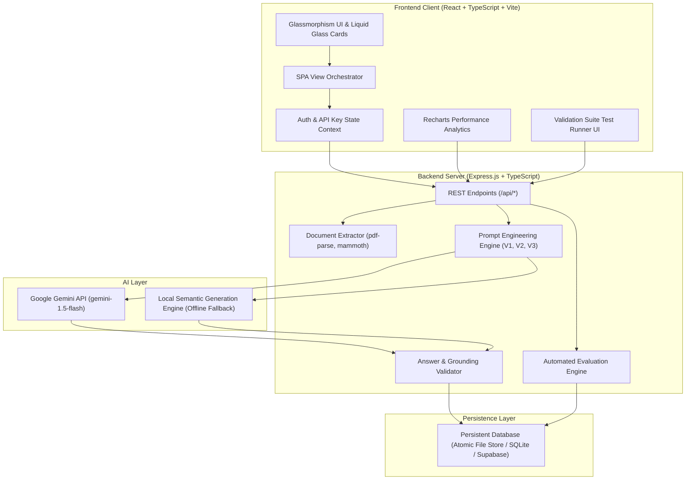
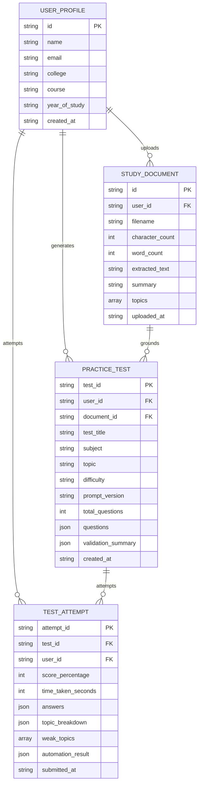

# PrepIQ — System Architecture & Design Documentation

## 1. System Overview

PrepIQ is built as a modular full-stack application following strict separation of concerns between client UI presentation, API orchestration, document processing, and AI validation services.

---

## 2. Component Structure

### Frontend (`/client`)
- **Technology**: React 18, TypeScript 5, Vite 5, Tailwind CSS 3, Lucide React, Recharts, Framer Motion.
- **Design System**: Apple-inspired Liquid Glass effects (`backdrop-filter: blur(16px)`), semi-transparent white cards (`rgba(255, 255, 255, 0.78)`), Cobalt Blue (`#1649E8`), Deep Navy (`#092B9B`), Electric Blue (`#245BFF`), and Neon Lime accents (`#A6FF00`).
- **Core Views**:
  - `LandingPage.tsx`: Hero section, Liquid Glass mockup, 5 core features, How-it-works progression.
  - `LoginPage.tsx` / `RegisterPage.tsx`: Supabase & local demo authentication, validation, session persistence.
  - `DashboardPage.tsx`: Student greeting, 4 KPI cards, recent exams, study notes library, topic insights.
  - `UploadPage.tsx`: Drag-and-drop file upload, text extraction preview, pre-loaded demo materials.
  - `GeneratorPage.tsx`: Comprehensive question configuration form with real-time multi-stage loading modal.
  - `PracticeTestPage.tsx`: Timed exam environment, question navigator palette, flag review, submission confirmation.
  - `ResultsPage.tsx`: Verified score breakdown, automated workflow execution log, validated answer key with source citations and rubric criteria.
  - `MyTestsPage.tsx`: Filterable historical exams list with direct review and retake actions.
  - `StudyMaterialsPage.tsx`: Document management, text preview modal, direct exam generation.
  - `AnalyticsPage.tsx`: Continuous performance charts powered by Recharts (score progression, subject accuracy, difficulty accuracy, weak topics).
  - `PromptLabPage.tsx`: System prompt inspector, specifications, and side-by-side prompt version comparison.
  - `TestSuitePage.tsx`: Live execution runner for the 5 mandated test cases with assertion telemetry.
  - `WorkflowDiagramPage.tsx`: Interactive visual explorer of the 8-stage processing pipeline.
  - `SettingsPage.tsx`: Student profile management, dynamic Google Gemini API key configuration with live connectivity testing, and demo reset.

### Backend (`/server`)
- **Technology**: Node.js v24, Express 4, TypeScript, Multer, PDF-Parse, Mammoth, Google Generative AI SDK.
- **Key Modules**:
  - `documentExtractor.ts`: Extracts text from `.pdf`, `.docx`, `.txt`, normalizes whitespace, extracts topics, and blocks files under 100 characters.
  - `prompts.ts`: Maintains System Prompt and definitions for Prompt V1, V2, and V3.
  - `gemini.ts`: Interacts securely with the Google Gemini API using structured JSON output modes.
  - `localGenerationEngine.ts`: Offline semantic generation engine that parses proposition sentences from source text and synthesizes valid MCQs, True/False, and Short Answer questions.
  - `answerValidator.ts`: Executes single-answer MCQ invariant checks, Jaccard duplicate detection (> 80% similarity threshold), and source text grounding calculations.
  - `evaluationEngine.ts`: Automated workflow handler that scores submissions, computes topic breakdowns, identifies weak topics, updates analytics, and records execution telemetry.
  - `testSuiteRunner.ts`: Automated runner verifying Test Cases 1 through 6.

---

## 3. Data Schema & Isolation

Data is strictly isolated by authenticated `user_id` and persists across server restarts in `server/data/store.json` (or PostgreSQL when Supabase is configured).

### Entity-Relationship Diagram

---

## 4. Security & Responsible AI Boundaries

1. **Secret Isolation**: Neither `GEMINI_API_KEY` nor backend database tokens are exposed to frontend bundle assets. API keys can be passed in server environment variables or dynamically submitted via authenticated headers (`x-gemini-key`).
2. **Hallucination Prevention**: The system prompt and answer validator reject questions that cannot be directly substantiated by the uploaded study material.
3. **No Fabricated Verification**: The system marks questions according to their true validation state: `verified` (direct factual source match), `rubric_evaluated` (criteria-checked), or `manual_review` (inference-based).
