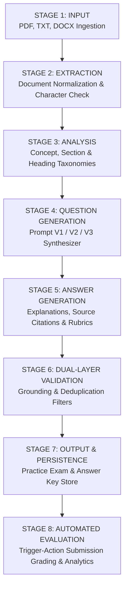
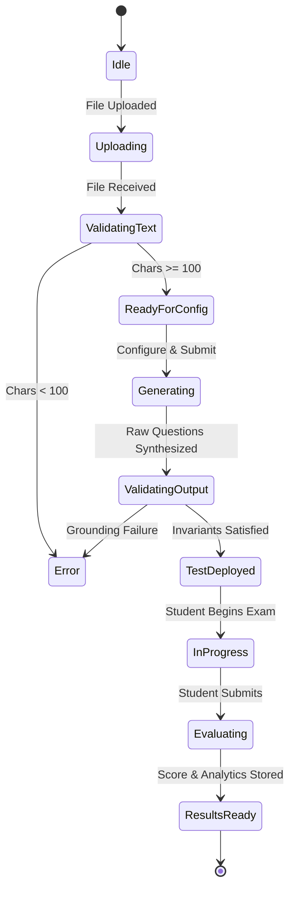

# PrepIQ — Workflow Pipeline & Lifecycle Specification

## 1. Executive Summary

PrepIQ is an AI-powered educational assessment engine designed to transform unstructured study materials (lecture notes, textbooks, research papers, and slide outlines) into rigorous, verified, and interactive practice examinations.

Unlike naive LLM wrappers that generate ungrounded questions prone to hallucination, PrepIQ employs an **8-Stage Processing Lifecycle** coupled with an **Automated Evaluation Engine** to ensure academic integrity, trace source grounding, and calculate rubric evaluations.

---

## 2. The 8-Stage Processing Lifecycle

### STAGE 1 — Input Ingestion
- **Objective**: Accept raw files or pasted text from the user while enforcing strict security and sanity boundaries.
- **Accepted Formats**: `.pdf`, `.docx`, `.txt`, `.md`.
- **Validation**:
  - Maximum payload size: 15 MB.
  - Multi-part file stream verification via Multer.
  - Rejection of corrupt or unsupported binary files with descriptive diagnostics.

### STAGE 2 — Text Extraction & Sanitization
- **Objective**: Extract raw readable character buffers and document metadata.
- **Implementation**:
  - `pdf-parse`: Decodes PDF streams, filters out binary formatting and streams.
  - `mammoth`: Extracts raw text from Microsoft Word `.docx` packages.
  - `utf-8` normalization: Cleans non-standard control characters, excessive tabs, and irregular whitespace.
- **Invariant (Edge Case Protection)**:
  - Minimum character threshold: `MIN_CHARS = 100` characters and `MIN_WORDS = 20` words.
  - Documents beneath this threshold trigger an immediate processing halt and alert the student before reaching AI generation models (**Test Case 2**).

### STAGE 3 — Concept Analysis & Topic Taxonomy
- **Objective**: Deconstruct the document into functional sections, definitions, and technical entities.
- **Execution**:
  - Section Identification: Matches regex patterns for chapters, sections, and capitalized headers.
  - Proposition Extraction: Detects definitional sentences (`"X is defined as Y"`, `"X refers to Y"`) and mechanism statements.
  - Entity Pool Harvesting: Compiles technical keywords to serve as distractors in multiple-choice questions.

### STAGE 4 — AI Question Generation
- **Objective**: Synthesize academic questions conforming to the student's selected configuration.
- **Configurable Parameters**:
  - Question count: 5, 10, 15, 20, or custom.
  - Target difficulty: Easy, Medium, Hard, or Mixed (Bloom's Taxonomy).
  - Allowed formats: MCQs (4 options), True/False, Short Answer, Fill in Blanks, Descriptive.
  - Prompt Version: V1 (Basic), V2 (Context-Aware), V3 (Grounded & Rubric-Validated).
- **Engines**:
  - Primary: Google Gemini API (`@google/generative-ai` with `gemini-1.5-flash`).
  - Fallback / Offline: Semantic Local Generation Engine ensuring 100% offline uptime and verification compatibility.

### STAGE 5 — Answer Key & Explanation Generation
- **Objective**: Construct designated answers, explanations, and precise section references.
- **Requirements**:
  - Every question must carry a `source_reference` (e.g., `"Section 5: Page Replacement Algorithms"`).
  - Explanations must directly support the designated answer.
  - Short-answer and descriptive questions must generate 2–3 objective `rubric_criteria` checkpoints.

### STAGE 6 — Dual-Layer Answer Validation
- **Objective**: Prevent hallucinated, ambiguous, or duplicate questions from reaching the final examination.
- **Verification Checks**:
  1. **MCQ Consistency Check**:
     - Ensures exactly one option matches the `correct_answer`.
     - Validates that no duplicate options exist within the choice pool.
     - Confirms option count equals 4 for MCQs and 2 for True/False (**Test Case 5**).
  2. **Jaccard Semantic Duplicate Filter**:
     - Tokenizes candidate question stems and compares against already generated questions.
     - Prunes questions with token overlap > 80% (**Test Case 4**).
  3. **Source Grounding Verification**:
     - Verifies that key entities in the question and answer actually exist within the source document.
     - Computes a global Grounding Score (0–100%). Questions below confidence thresholds are rejected or tagged for instructor review (**Test Case 3**).

### STAGE 7 — Output Formatting & Persistent Storage
- **Objective**: Package the validated questions into a standardized JSON examination schema and commit to persistent storage.
- **Persistence**:
  - Stored in SQLite / JSON storage with atomic writes.
  - Schema captures `test_id`, `user_id`, `document_id`, `questions`, and `validation_summary`.

### STAGE 8 — Automated Evaluation Workflow
- **Objective**: Complete end-to-end evaluation upon student submission without any manual intervention.
- **Automation Pipeline**:
  1. Evaluates student responses (tolerant matching for objective answers, transparent keyword/length rubric scoring for descriptive responses).
  2. Aggregates total score, percentage, correct, incorrect, and unattempted counts.
  3. Decomposes performance by topic and flags weak areas with scores < 70%.
  4. Generates targeted improvement recommendations.
  5. Commits `TestAttempt` record to persistent storage.
  6. Recalculates student running average score, total tests attempted, and questions practiced on the live dashboard.
  7. Surfaces verifiable automation execution telemetry (execution time in ms).

---

## 3. State Transition Diagram

